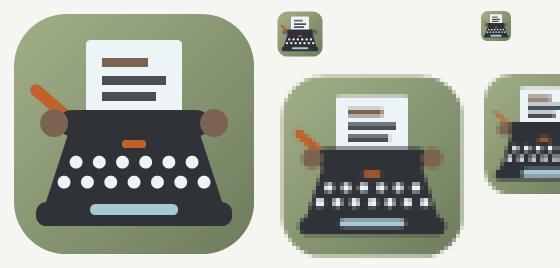

# Scripta Sync Server (Windows)

A small tray app that shares one folder on your PC with the Scripta writerdeck over WebDAV.
It runs [rclone](https://rclone.org) in the background and gives you a window to start and stop it,
see the address and password to type into the device, and choose whether it starts automatically.



## Install

1. Download this repository (green **Code** button > **Download ZIP**) and unzip it.
2. Open `tools\sync-server` and double-click **`Install.cmd`**.
   - If rclone is missing it offers to install it with `winget`.
   - It builds the app on your PC with the C# compiler that is part of Windows (nothing else to download).
   - It asks once for admin rights to let devices **on your local network only** reach port 8080.
3. The app opens. Choose the **Vault folder** to share (default `Documents\Scripta`), then press **Start server**.

You will then find **Scripta Sync Server** in the Start menu, on the desktop and in the system tray.

## Connect the device

On the Scripta: **Wi-Fi & sync**, then:

- **Server URL**: the *Device URL* from the app, plus a folder inside the vault folder, e.g. `http://192.168.1.20:8080/Scripta`.
  That folder must already exist on the PC.
- **User / Password**: as shown in the app (press **Show** to reveal the password).
- **Folder to sync**: the folder on the SD card to mirror, e.g. `/Scripta`.

Press Ctrl+R on the device to sync. Give the PC a fixed IP address (a DHCP reservation in your router) so
the URL does not change.

## Using the app

| | |
|---|---|
| Tray icon | Typewriter with a green dot = running, red dot = stopped. Left-click opens the window; right-click for Start/Stop, Restart, Copy URL, Quit. |
| Start the server when this app opens | Off by default. |
| Open this app in the tray when I sign in to Windows | Off by default. Together with the option above, the server is always on while you are signed in. |
| Browse / Folder / Log | Open the server in a browser, open the shared folder, or view rclone's log. |

Closing the window keeps the app in the tray. **Quit** (tray menu) also stops the server.

Settings live in `settings.ini` next to the app (`%LOCALAPPDATA%\Programs\ScriptaSyncServer`). A random
four-word password is created on first run; change it in the window. If you change `Port` in `settings.ini`,
re-run `install.ps1 -Port <n>` to open the new port in the firewall.

The server is plain HTTP, meant for your home network. Don't forward the port on your router.

## Uninstall

```powershell
powershell -ExecutionPolicy Bypass -File install.ps1 -Uninstall
```

This removes the app, its shortcuts, the sign-in entry and the firewall rule. Your shared folder and rclone stay.

## Files

| File | |
|---|---|
| `ScriptaSyncServer.cs` | the app (WinForms, .NET Framework 4.x) |
| `build.ps1` | compiles it; `-OutDir` picks where |
| `install.ps1`, `Install.cmd` | installer / uninstaller |
| `make-icon.ps1` | draws `scripta-server.ico` and `icon-preview.png` |
